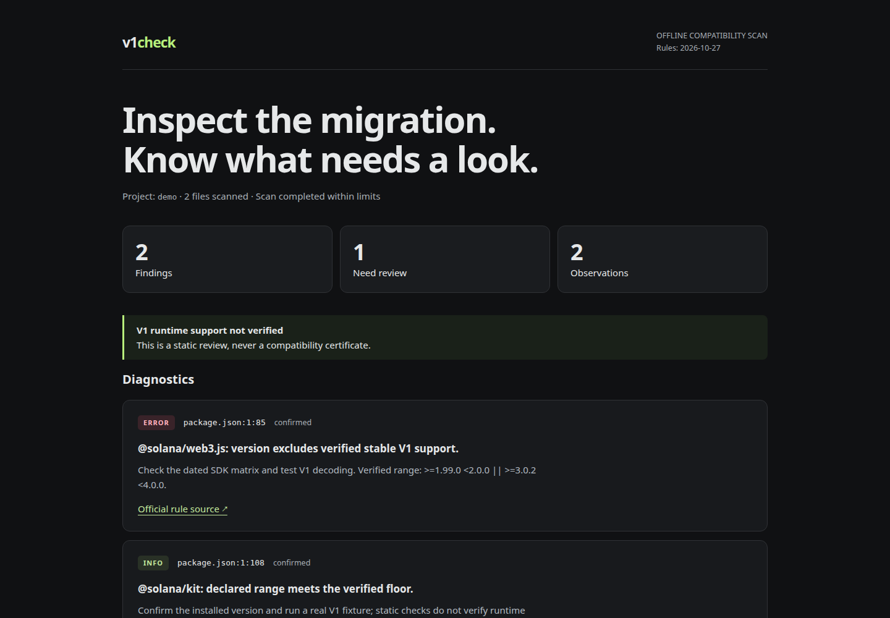

# v1check

Find Solana Transaction V1 migration issues before they surprise your app.



[](https://github.com/royalpinto007/v1check/actions/workflows/ci.yml)
[MIT](LICENSE) · [Architecture](docs/architecture.md) · [Rules and limits](docs/rules.md)

```sh
npx v1check ./my-solana-app
npx v1check ./my-solana-app --format html --output review.html
```

Node.js 22.18+. Open `review.html` in your browser. No server needed.

- Scan SDK declarations and npm, Yarn or pnpm lockfiles.
- Find V1-excluding RPC settings with file and line references.
- Separate confirmed settings from dynamic code needing review.
- Export text, Markdown, JSON or a dark, standalone HTML report.

**A static scan never proves V1 compatibility.** Unknown code, RPC behavior, wallets and real transaction decoding need runtime tests. Legacy and v0 transactions remain valid.

### Try the example

```sh
npx v1check --demo --fail-on never
```

The bundled project is fictional. Its code is parsed, never run.

### Work locally

```sh
git clone https://github.com/royalpinto007/v1check.git
cd v1check
npm install
npm run demo
npm run check
```

### CLI

`--format text|markdown|json|html`, `--output PATH`, `--fail-on error|review|never`.

Exit `0`: below threshold. Exit `1`: findings meet the threshold or scan is partial. Exit `2`: usage or I/O error. `--fail-on never` always permits findings, including partial scans. Exports refuse to overwrite existing files.

No network calls while scanning, no wallet, no automatic edits. Only an explicit `--output` writes a report. Installing through npm uses the network. Reports include relative paths and diagnostics, never source snippets.
