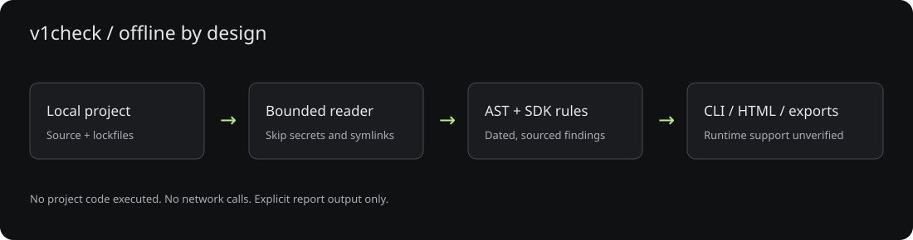
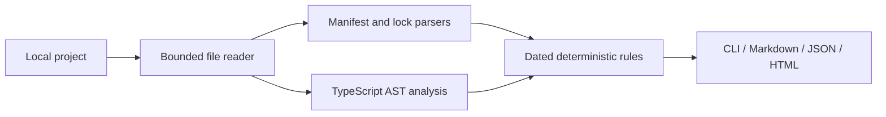

# Architecture

The filesystem adapter reads allowlisted files without executing code. Dependency and source analyzers return file references and diagnostics. The report layer escapes untrusted values and always states runtime support is unverified. Only the CLI can explicitly create a report file.

There is no server, database, telemetry or RPC client. Rules ship with the package so scanning works offline. TypeScript is a runtime dependency for syntax analysis, not compilation of the inspected project.
